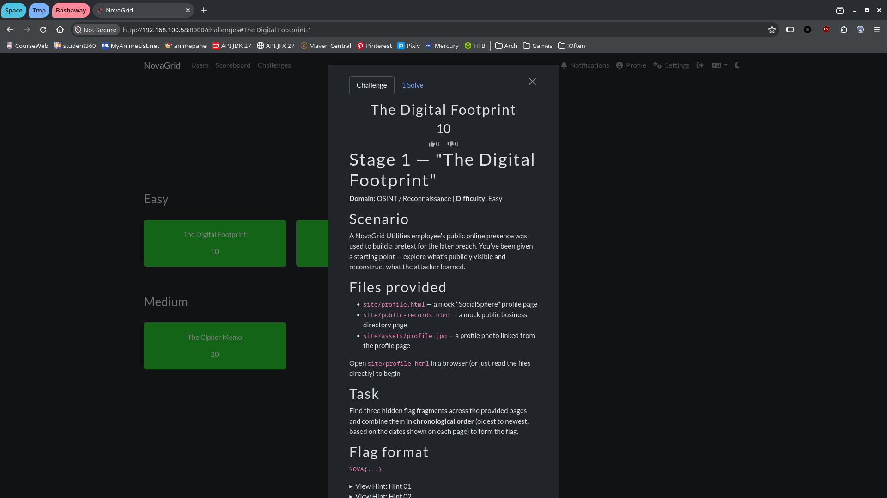
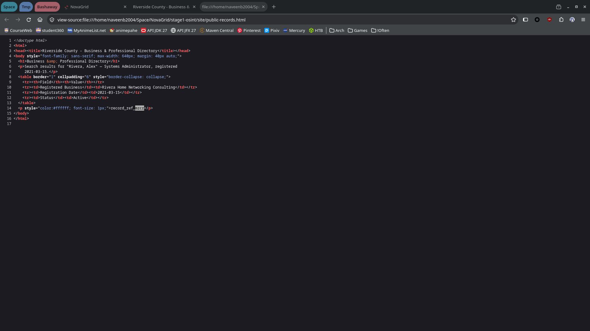
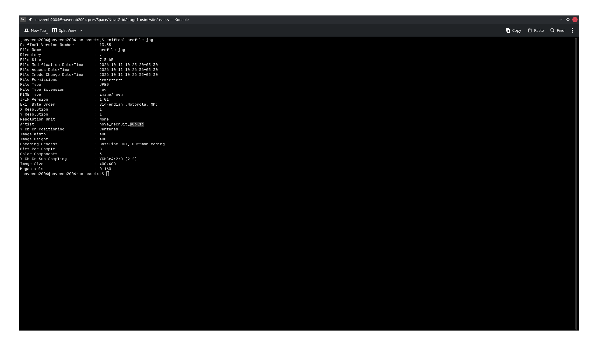
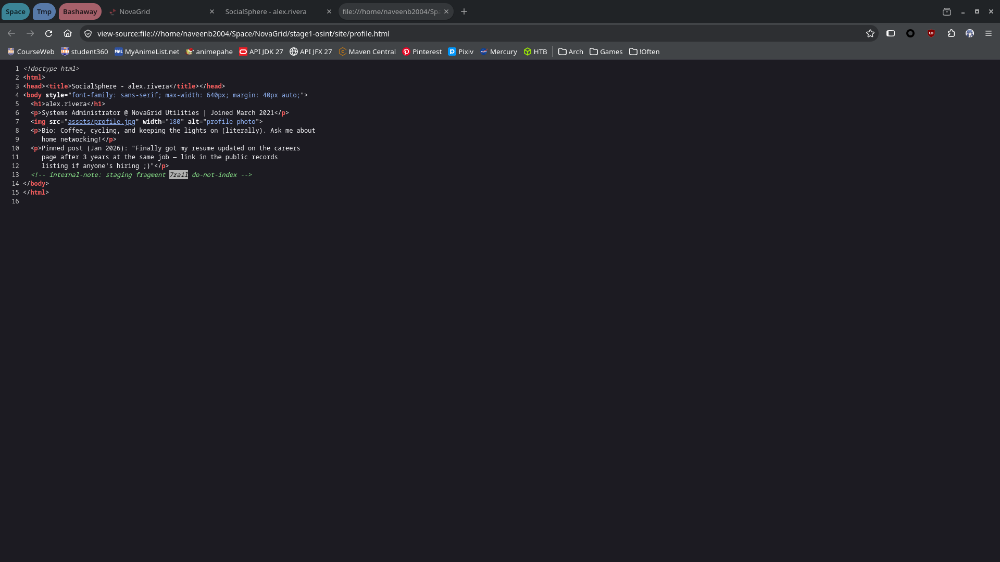
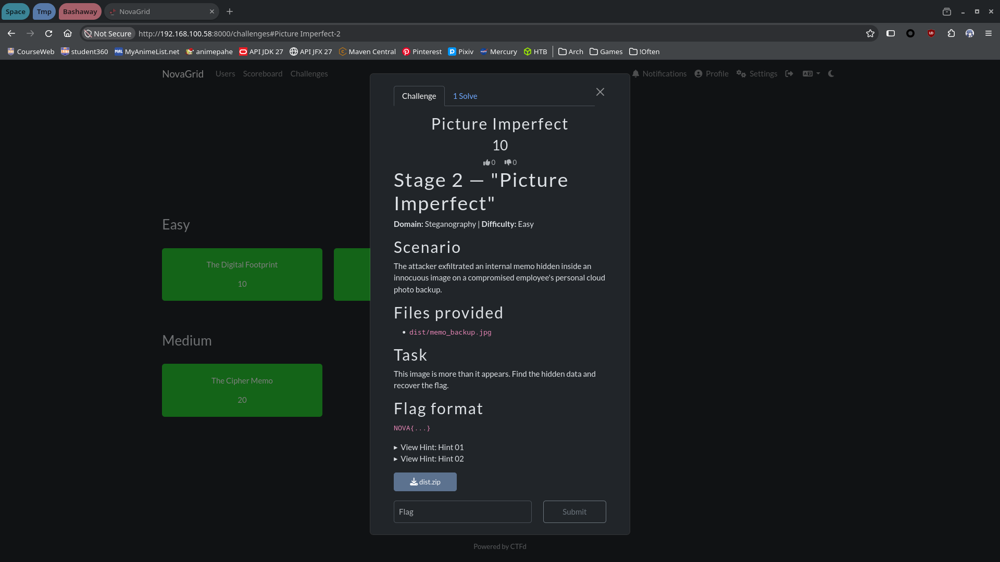
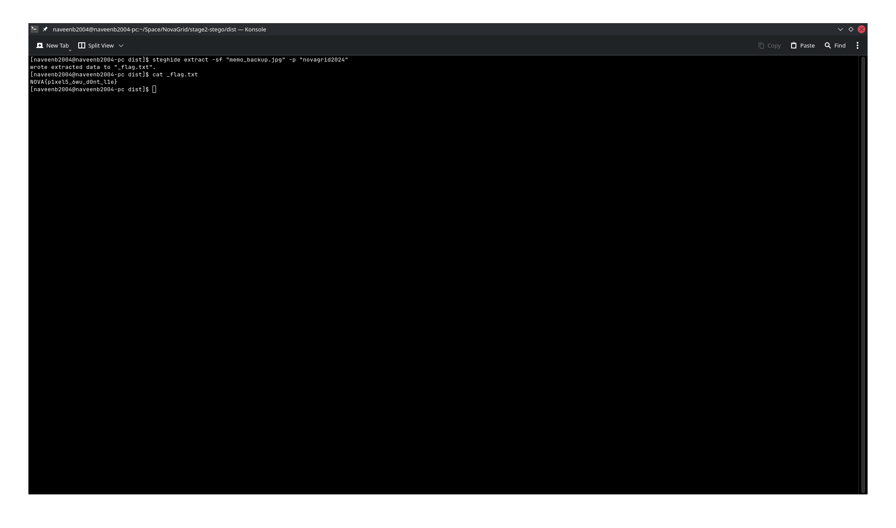
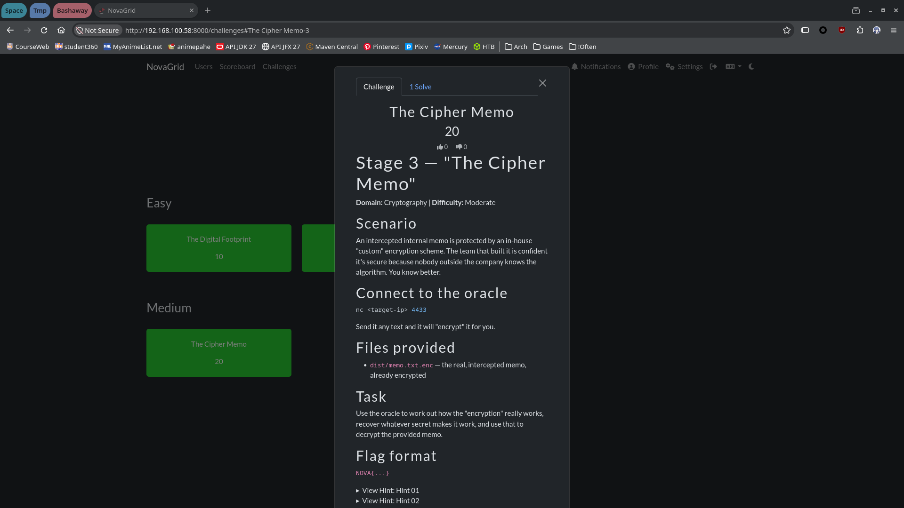
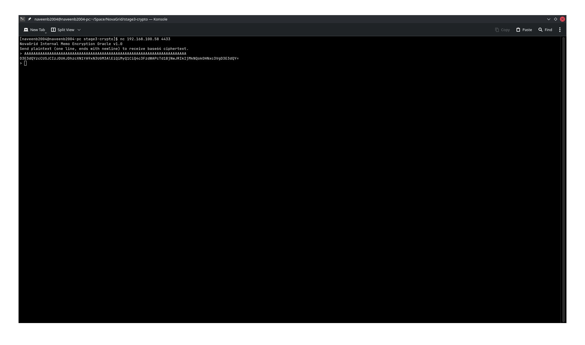
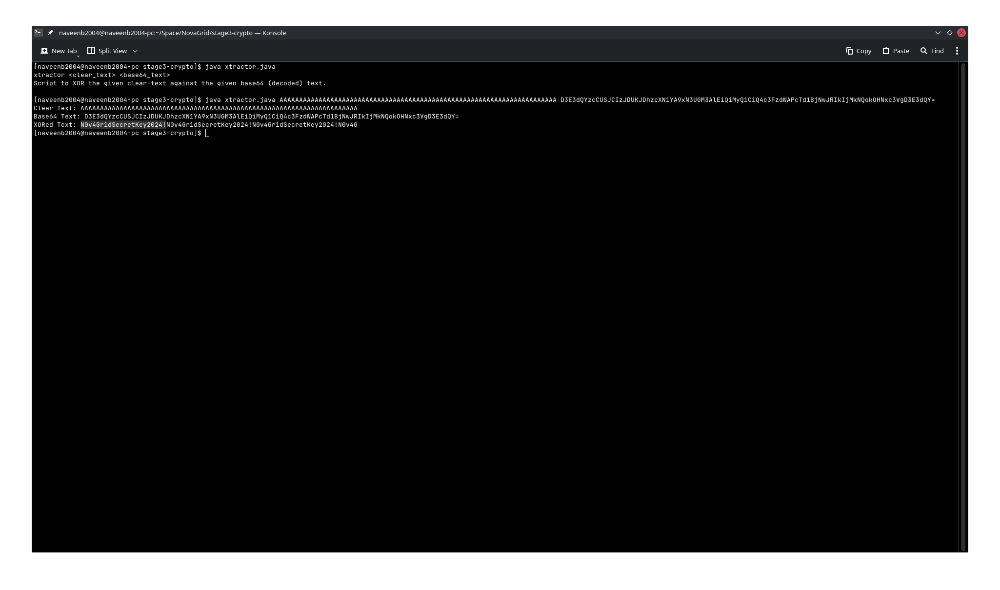
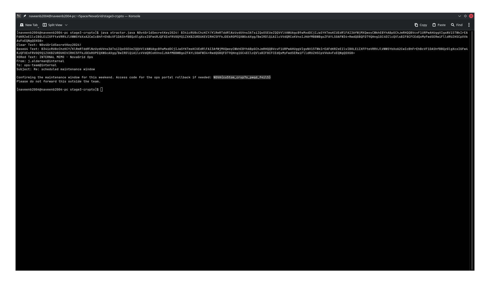

## Evidence for CTF Box
## IT24102019 - Balasooriya N. N.

### Stage 1

> CTFd challange

> 1st flag fragment

> 2nd flag fragment

> 3rd flag fragment

### Stage 2

> CTFd challange

> Extracted flag

### Stage 3

> CTFd challange

> Connect to the crypto service and encrypt dummy text

> Use custom script to extract passphrase

> Use extracted passphrase to decrypt given encrypted note

